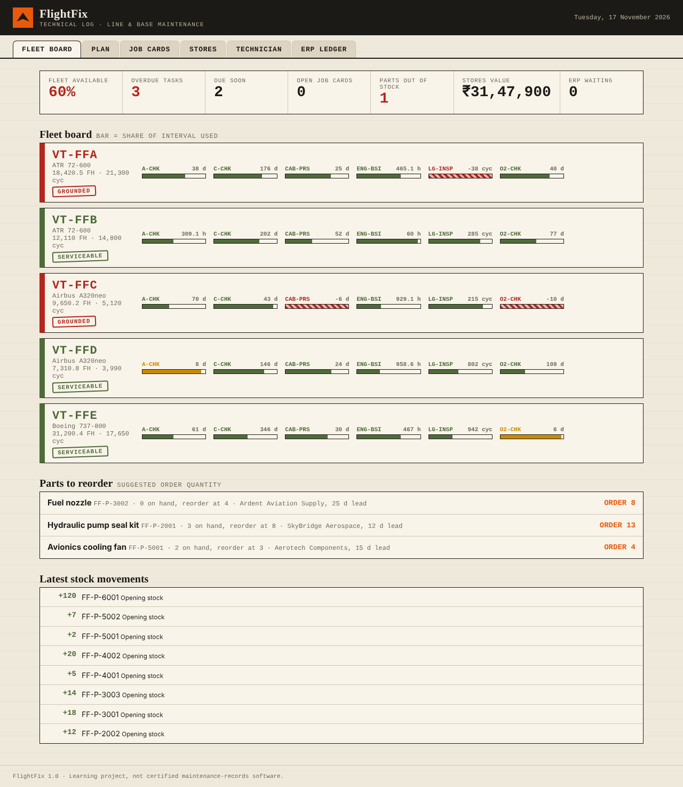

# FlightFix

**Aircraft maintenance efficiency: an MRO (Maintenance, Repair & Overhaul) system** with maintenance planning and
scheduling, spare-parts inventory, ERP integration and mobile technician access.

Python 3.12 + Flask 3 + SQLite + vanilla JavaScript. One dependency (Flask), no build step, no database server.

Individual project by **Samriddhi Bisht** (Roll No. 2300320230049), ABES Engineering College.
Mentor: Dr. Anamika Goel. HCLTech Career Shaper Programme.



## What it does

| Area | What you get |
|------|--------------|
| **Planning** | Every aircraft task is due on whichever limit comes first: flight hours, landing cycles or calendar days. Tasks are classified OK / DUE SOON / OVERDUE and ranked by urgency. One click raises job cards, without duplicates. |
| **Job cards** | Scheduled and defect jobs (LOW, NORMAL, HIGH, AOG). Start, issue parts, sign off with labour hours, or cancel. Sign-off resets the task counters. |
| **Stores** | Parts with part number and barcode, stock by quantity, reorder level, supplier and lead time. Stock can never go negative. Every change is logged in a movement ledger. |
| **ERP** | Sign-off writes its parts and labour cost to an outbox in the same commit. Sync retries failures and uses an idempotency key, so a retry never double-posts. Goods receipts from the ERP come back in as stock. |
| **Technician (mobile)** | Phone-friendly screen: my jobs, open queue by priority, scan a part number or barcode, issue parts, sign off. |
| **Dashboard** | Fleet availability, overdue and due-soon tasks, parts to reorder with suggested quantity, ERP queue. |

## Quick start

```bash
# Linux / macOS
./run.sh

# Windows
run.bat

# or manually
pip install -r requirements.txt
python run.py
```

Open <http://localhost:5000>. The first start seeds a demo airline base (5 aircraft, 6 task templates, 12 parts,
4 technicians) into `./data/flightfix.db`. Delete the `data/` folder to start fresh.

## Try the whole flow in two minutes

1. **Plan** tab, then *Generate job cards*.
2. **Technician** tab, pick a technician, *Start job* on a card.
3. Scan or type `FF-P-4002` (or any part number or barcode from the **Stores** tab), *Issue part*.
4. Enter labour hours, *Sign off*. The task goes back to OK on the fleet board.
5. **ERP ledger** tab, *Sync with ERP*. A document number appears. Receive goods with *Goods receipt from ERP*.

## Tests

```bash
python -m unittest tests.test_flightfix -v
```

Twelve acceptance tests (TC1-TC12) drive the real API: duplicate codes, negative-stock refusal, all-or-nothing part issue,
sign-off, ERP outage and idempotent retry, reorder alerts and goods receipts.

## Configuration

| Variable | Purpose |
|----------|---------|
| `FLIGHTFIX_TODAY` | Pin "today" (`YYYY-MM-DD`) for repeatable demos and tests |
| `FLIGHTFIX_ERP_URL` | Post to a real ERP gateway instead of the built-in `MockERP` |
| `FLIGHTFIX_ERP_TOKEN` | Bearer token sent with `FLIGHTFIX_ERP_URL` postings |

## Project layout

```
flight-fix/
  flightfix/
    app.py         Flask app: 21 REST endpoints, error handlers
    services.py    planning engine, work-order lifecycle, single stock gateway, KPIs
    erp.py         outbox, retry, MockERP and HttpERP connectors
    db.py          SQLite schema (9 tables, constraints)
    seed.py        demo data
    static/        index.html, app.css, app.js (single-page UI)
  tests/           12 acceptance tests
  docs/            project synopsis and source/output document (PDF), screenshots
  run.py  run.sh  run.bat  requirements.txt
```

## REST API (21 endpoints)

| Method | Route | Purpose |
|--------|-------|---------|
| GET, POST | `/api/aircraft` | List or register aircraft |
| GET | `/api/plan` | Due status of every task, most urgent first |
| POST | `/api/plan/generate` | Raise job cards for overdue / due-soon tasks |
| GET, POST | `/api/work-orders` | List (`?status=`, `?technicianId=`) or report a defect |
| GET | `/api/work-orders/{id}` | One job card with parts |
| POST | `/api/work-orders/{id}/start` | `{technicianId}` |
| POST | `/api/work-orders/{id}/issue-part` | `{items:[{partId, qty}]}` all or none |
| POST | `/api/work-orders/{id}/complete` | `{labourHours}` sign off and queue ERP posting |
| POST | `/api/work-orders/{id}/cancel` | Cancel an open or in-progress card |
| GET, POST | `/api/parts` | List (`?q=`) or add a part |
| POST | `/api/parts/{id}/adjust` | `{delta, reason}` |
| GET | `/api/parts/lookup/{code}` | Part number or barcode lookup |
| GET | `/api/technicians` | Technicians |
| GET | `/api/technicians/{id}/tasks` | Mobile view: my jobs and open queue |
| GET | `/api/erp/outbox` | ERP postings and their status |
| POST | `/api/erp/sync` | Push pending postings |
| POST | `/api/erp/receipts` | `{partNo, qty, poRef}` goods receipt |
| GET | `/api/reports/kpis` | Dashboard KPIs, reorder alerts, recent movements |

Errors return JSON `{ "message": ... }` with 400 (bad input), 404 (not found) or 409 (conflict, e.g. would go negative).

## Notes

- Learning project. It is not certified maintenance-records software and must not be used for real airworthiness decisions.
- All data is synthetic. Technician licence numbers are fictitious.
- One shared SQLite connection with a request lock: ideal for a demo or small team. Move to PostgreSQL for heavy concurrent use.
- Claude (Anthropic) was used for code assistance and drafting the synopsis, as declared in the project report.

Licensed under the MIT License.
